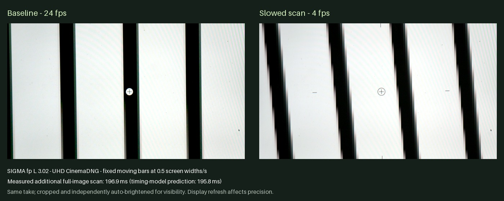
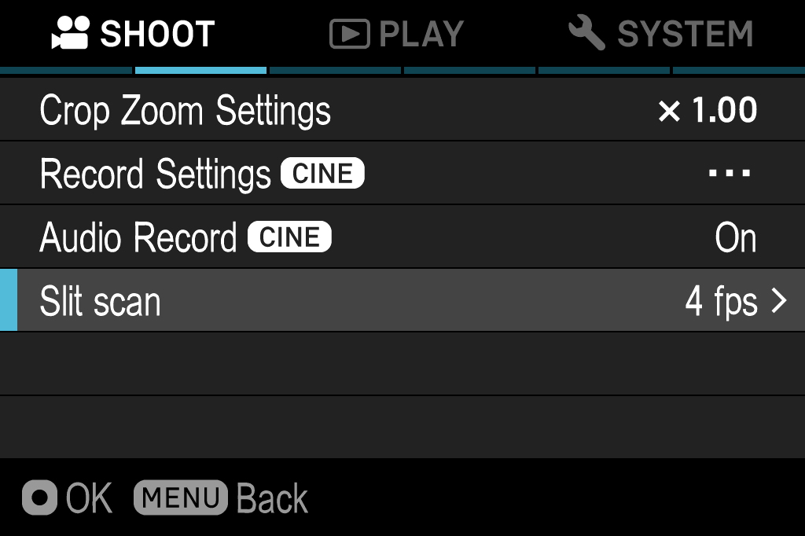

# fp L slit-scan development — 26 October 2026

Target: fp L 3.02. Active optical scan slowdown is now measured on camera.
This is an active implementation record, not a released standalone product.

**Current status:** USB-host capture and native RAM-only menu selection are
live-tested. Standalone timing/recording integration, boot installation and
repeated power-switch acceptance remain unfinished. Earlier sections below
record the successive experiments; later follow-ups supersede their open gaps.



These are real frames from the same fixed-target take, cropped identically and
independently brightened for visibility; no geometric correction was applied.
The raw files remain external. [Image provenance](images/slit-scan/provenance.json)
records the source-frame hashes, crop and processing.

## Live results

`fp_usb_shell/fpl_vd_probe.py` and `asm/fpl_vd_probe.S` implement a finite
RAM-resident observer of the **early Vd callback at C31D6DD8**. The native
Thumb IRQ handler C0121D18 loads it, checks C31D6DDC == 1 and BLX-calls it
before its ordinary processing. The callback makes no firmware calls: it
reads the native timer5 counter at 2D810054, TickTimer seconds at C3076D98,
timing registers and the scan counter at 30100590. It self-detaches after a
bounded number of observations. The host uses the existing staging lock and
a durable pending marker; another staging operation cannot overwrite it.

The runtime timer base is 2D810000, and C2F09408 contains 12,000,000 Hz.
Native `C00165E8(5, out)` reads that same timer counter. The callback and shell
both report MPIDR 80000000; the callback's CPSR mode is IRQ (0x12).

| Trial | Result |
| --- | --- |
| 120 observations, ordinary live view | 59.94007 Hz, median 16.68317 ms |
| Live-view interval x1.01 | Changed interval about 16.855 ms, then restored |
| Live-view interval x1.10 | Changed interval about 18.352 ms, then restored |
| CinemaDNG 3840x2160 / 8-bit / nominal 24, x1.10 | About 45.802 ms; sampled whole DNGs decode with LibRaw |
| Same recording mode, x2 | About 83.333 ms (12 fps); sampled whole DNGs decode |
| Same recording mode, x6 | About 250 ms (4 fps); sampled whole DNGs decode |

The timing experiment records 8 baseline observations, changes **only
30100004's two interval fields** for 80 observations, restores the original
word, then records the remaining baseline observations. It never changes the
frame-count register 30100020, sensor packets, PLLs, voltages, or firmware
storage. Teardown also restores an outstanding trial, but only if the current
registers still match this trial's values and mode. A mode change is reported
rather than overwritten with stale timing.

During the measured UHD recording:

* Original 30100004 = 020B047B, so a=524 and b=1148.
* 30100020 = 165B0000, so c=5724.
* `(a*(c-1)+b)/72,000,000 = 1/24 second`, matching the observed Vd cadence.
* x6 writes 0C471AE7 (a=3144, b=6888), and observes 1/4 second.

### Optical confirmation after the laptop stopped moving

`vd-bars-fixed-600` / camera take A001_012 contains the decisive comparison.
The browser acknowledged moving bars at 0.5 screen widths/s (four periods per
width), visible, with approximately 60 rAF draws/s. Camera exposure was mode 1,
1/1000, ISO100. Whole DNGs 1, 60 and 140 decode with LibRaw.

`tools/fpl_scan_measure.py` fits a row-wise horizontal Fourier phase slope.
Using half-resolution CFA averages, period 256 pixels and crop
`(400,220,1300,720)`, frame 1 versus frame 60 gives **196.875603 ms** added
full-image scan time. Restored frame 140 versus frame 60 gives **196.677698 ms**.
The timing model predicts approximately **195.84 ms**. This confirms genuine
optical scan slowdown, beyond merely extending the frame interval. Top/bottom
sub-crops give about 178–192 ms; display refresh, perspective and extrapolation
from a crop limit precision. It does not independently measure the physical
clock frequency or establish other camera modes or exposure compensation.

The earlier `vd-bars-600` / A001_011 was obstructed while the laptop was being
adjusted and is excluded from optical evidence. The preceding fan/blank-wall
takes were inconclusive optically.

The self-contained target lives in `tools/slit-scan-target/index.html`.
`server.py --bind 127.0.0.1 --port 8127` serves local controls (use a configured
trusted-LAN address for remote controls):
POST `/api/state` selects mode/speed/pause/direction/control visibility;
GET `/api/client` returns browser acknowledgements and their receive time.
Animation uses browser-local time; 250 ms HTTP polling only delivers controls.
Check fresh acknowledgement before recording. Downloaded HTML works offline.

## Evidence and restoration

External evidence from 26 October:
`vd-idle-1`, `vd-timing-101`, `vd-timing-110`, `vd-record-110` (A001_007),
`vd-record-200` (A001_008), `vd-record-600` (A001_009). Each probe directory
holds the exact padded code, SHA-256 manifest, timestamped events and raw
capture. Recording directories additionally hold sampled full DNGs and local
contact sheets. Full captures remain external; the cropped
comparison above is included as source documentation, not a release artifact.

Code SHA-256: passive first probe
`ebbd3eb936c9077c269e5418e37df3554b4ca2ede5769bc4a77dce609821760d`;
timing trials
`8d03a863fff4ac439e5752e69315abd3dd79033ffe691e12093bcc0956f25fc3`.
Addresses in manifests describe those trials, not reusable allocations.

All above trials completed, self-detached, restored timing, removed their
pending markers and left the CinemaDNG owner idle. For x2/x6, exposure was
temporarily changed to mode 1, 1/1000 and ISO3200. The original mode 3,
shutter 0/0 and ISO320 were saved in `exposure-original.json` and restored
with readback after x6. The owner physically switched STILL to CINE and
prepared the scene; that requested switch was kept. No boot file was changed.

For the later target trials, ISO had changed to Auto. Those trials saved and
restored mode 3, shutter 0/0, ISO0 (Auto). Each new trial must capture its own
current settings rather than reuse a historical exposure backup.

The original daemon exited during a `status get app_current` request before
any probe writes. Its existing reviewed binary was restarted at the short
socket `~/.cache/fpsup/fpshd.sock`; version and MCAPS succeeded. Subsequent
trials used the documented recording-owner observations and no status command.

## Checks

With the scoped toolchain on PATH and official `FPL_MAIN` supplied:

```
cd fpSup/fp_usb_shell
python3 -B -m unittest -v test_fpl_vd_probe
```

Eight tests pass: actual native Thumb dispatch to the emitted ARM callback,
callee-saved registers/stack/interrupt state, finite capacity, foreign-slot
refusal, early detach, normal/early timing restoration, foreign-mode refusal,
timer wrap, and mutations removing self-detachment and timing restoration.
Unrelated IRQ service calls and hardware progression are modeled. Optical
sensor behavior is not modeled.

RAW-image analysis used a Python environment with rawpy 0.27.1, pillow 13.0.0,
tifffile 2026.10.15 and numpy 2.5.4.

## Initial acceptance plan (see subsequent results below)

1. Repeat the optical measurement at additional rates and quantify short
   exposure behavior with fixed illumination.
2. Implement usable rate selection, short per-row exposure handling, one-shot
   image and video capture, and error/stop restoration.
3. Validate repeated captures, start/stop transitions and timing metadata.
4. Integrate accepted code through shared boot/product services and UI; never
   label the finite USB experiment as a standalone installable camera feature.

Magic Lantern reference: `src/fps-engio.c`, High Jello optimization (Timer A
slows row cadence; menu recommends 2–5 fps and a fast shutter). Existing fp L
precursors: `FPL_SENSOR_MODE_PACKET_COMPARISON.md`,
`FPL_SENSOR_TIMING_FEASIBILITY.md`.

## USB capture workflow implemented later on 26 October

`fp_usb_shell/fpl_slit_scan.py` composes the existing GTAG observer and the
finite Vd callback into one reserved worker-staging allocation and one durable
ownership marker. `END_COUNT` supplies a finite capture length; `FRAME_INDEX`
records the native DNG-notify index beside each Vd sample. `WATCH_MODE` aborts
when another mode/timing owner changes the registers. The shared loader is
unchanged: this is a host-installed temporary RAM payload, not a card product.

User entry point: [`tools/slit-scan-camera`](../tools/slit-scan-camera/README.md),
served by default at `http://127.0.0.1:8128/`. The earlier target
page remains on port 8127. Photo is a selected UHD RAW frame from a short CINE
take; video exports a numbered DNG sequence. Controls offer 4/6/8/12 fps,
estimated 1/250–1/1000 row exposure, fixed ISO and duration, with Stop.

New live evidence (detailed captures retained externally):

| Local result | Camera take | Result |
| --- | --- | --- |
| `slit-photo-4-1` | A001_013 | GTAG-confirmed frame 30 exported; 4.00000094 Hz; optical added scan 190.80 ms against initial / 201.01 ms against restored frame |
| `slit-video-8-1` | A001_014 | Frames 28–35 exported; all eight decode; 8.00000052 Hz |
| `slit-exposure-12` | A001_015 | 12.000004 Hz, stock 1/2000, estimated 1 ms row exposure |
| `slit-exposure-6` | A001_016 | 5.9999985 Hz, stock 1/4000 (native reports 260 us), estimated 1.04 ms |
| `slit-exposure-4` | A001_017 | 4.00000083 Hz, stock 1/6400 (native reports 156 us), estimated 0.936 ms |
| Browser cancellation | A001_018 | SIGTERM delivered while timing was active; recorder idle, callback/observer removed, marker absent, mode3/shutter0/0/ISO0 restored |
| Browser video | A001_019 | Four tagged frames 32–35, 4.00000035 Hz, ISO800, metadata format 2 with corrected timecodes |

The browser-video preview shows the laptop's screensaver, despite the browser still
acknowledging visible animation. It verifies the capture/export workflow, not
another optical fan result. Browser visibility cannot establish that the
physical display is showing the tab.

The paused-bar exposure comparison uses the same screen crop: 90th–10th
percentile RAW contrasts were 108, 108 and 96 at 12, 6 and 4 fps. This supports
the compensation direction and approximate constant exposure; quantization,
black-level differences, low signal and display behavior preclude precise
calibration. Native shutter readback is now included in the exposure estimate.

Every finished/aborted workflow restored the latest originals (mode 3, shutter
0/0, ISO0/Auto), with the physical switch remaining CINE. Pending callbacks and
recording were checked idle after the cancellation test. No firmware or boot
files were changed. The raw callback's original fixed-length tests still pass;
the packaged configurable callback is executed through the native IRQ path at
1, 24 and 480 selected-frame plans, with a foreign-mode exit and an independent
mutation removing its restore MMIO store. The existing native GTAG tests were
rerun with the fingerprinted 23-October DNG-prefix fixture, not a substituted
new image. Host tests cover export metadata, hash-checked resume, exposure
restore failure and pending-marker retention.

Export format 2 changes only existing TIFF FrameRate/TimeCodes values, leaving
pixel bytes intact. EXIF ExposureTime remains the stock shutter; the sidecar
explicitly labels estimated effective exposure. Earlier research exports use
format 1 (FrameRate only) and remain preserved as evidence.

## Native menu port: verified layout and current installation gap

The shared UI sources are for fp 5.02. `tools/fpl_ui_audit.py` locates fp L
counterparts by instruction shape against both fingerprinted official images;
matching is a locator, not permission to call or patch a function. The NBU
string pool (176,152 bytes) and inspected MainB2/B2_5 resource ranges are
byte-identical between the images, at their respective bases.

`fp_usb_shell/fpl_ui.py` now provides bounded **read-only** verification on fp L
3.02. The live snapshot on 26 October confirmed:

| Binding | fp L 3.02 evidence |
| --- | --- |
| GUI getter | ARM `C055B208`; initialized return is `C37B6B10`, not singleton base `C37B6AFC` |
| UI app | `[C37B6B10]`; 221 screens, count at app+80, array at app+8C |
| Reader | screen+24; pool length/pointer at +10/+14 = 176152/`C18D01B4`; NBU base +24 = `C18D01A0` |
| Runtime pages | +A8/+AC = count/table, 221 records of 44 bytes; name +04, source offset +08 |
| Target pages | MainB2 offset `76FF04`, B2_5 offset `19C130`; live names and offsets matched |
| Variable registry | `[app+888]+60`; 2,198 variables; name map is **embedded** at registry+14 |
| String leaves | Thumb `C05E1D39`, `C05E23A9`, `C05E23C1`; first eight bytes still stock |

UI heap pointers in this boot use the cached `C6...` range. They are not USER
DMA addresses and must not be reused after reboot. Private evidence is
`ui-runtime-layout.json` (initial reads) and `ui-runtime-verified.json` (the
bounded verifier); both live under the existing 26-October evidence directory.

Additional reviewed candidates: register variables Thumb `C05D74E9`, registry
lookup Thumb `C05D75F9`, app-registry getter Thumb `C05D6091`, integer subscription
ARM `C055D0C8`, integer post ARM `C0590078`, string post ARM `C0590128`.
The integer-post locator found three identical-shape wrappers. The selected
`C0590078` has 668 direct ARM BL callers, matching the fp notifier wrapper's
role; `C0598E10` and `C059B760` have 140 and 49. Call counts alone do not prove
queue ownership or live rendering.

With the scoped ARM toolchain on PATH and the official `FPL_MAIN` supplied:

```
cd fpSup/fp_usb_shell
python3 -B -m unittest -v test_fpl_ui
FPSHD_SOCKET="$HOME/.cache/fpsup/fpshd.sock" python3 -B fpl_ui.py \
  --main "$FPL_MAIN" --out /path/to/new-ui-snapshot.json
```

**Six offline tests passed.** Actual firmware instructions execute the
initialized GUI getter, registry getter, name lookup/hash/search, and integer
notification construction. Singleton guards, strcmp, memset and queue
services are explicitly modeled where used. Actual fp L string leaves are
compared with the existing shared `ui_strings.S` for boundary offsets/pointers;
two layers resolve/borrow private strings with aligned and 4-byte-skewed stacks.
A private-image mutation forcing a string-range miss is detected. These tests
invoke the layers directly: they do **not** install a hook or render a page.

At the read-only investigation stage, the installation gap was concrete:
`ui_pool.c` uses fp cave veneers and fp
Loader-v3 publication words. The fp L profile explicitly has **no cave**; that
image area belongs to the IMU firmware. Shared string semantics are compatible,
but copying those installer addresses would be incorrect. A cave-free transfer
also needs a verified installation/quiescence boundary, stock-byte journaling,
and lifetime through shutdown. The existing fp L eight-byte level-hook study
is offline/quiescent-only and does not establish that boundary for GUI leaves.
At that stage, native variable registration/subscription and added-row rendering
were still unverified; the later trials below verify them. Resident slit-scan
recording and boot/power-off acceptance remain unfinished.

That read-only UI investigation made no camera writes. The recorder was idle, the early
Vd callback table stock, and the three string leaves unmodified. No boot/card
file or persistent setting was changed.

### Cave-free hook roundtrip — verified later on 2026-10-26

[The cave-free hook experiment](FPL_UI_HOOK.md) now implements the eight-byte
absolute transfers in owned memory, validates saved task PCs with IRQ/FIQ
excluded, and executes install → string checks → full restoration in one finite
camera call. Both **one layer and two nested shared string layers passed on the
fp L**; private/stock strings resolved and all six original words were restored.
The 19 relevant instruction tests pass, including deliberate PC-guard and
restoration mutations. Evidence, hashes and reproduction commands are in that
record. Later trials below add shared-loader journaling and resident menu
selection; standalone recording and power-switch acceptance remain unfinished.

### Additive row and native controller — offline, 2026-10-26

`slit_scan/menu.py` builds a SHOOT 2 **Slit scan** row from the same-page Audio
donor using `uishare/ui/rows.py`. The whole 154,188-byte MainB2 resource and
the stock string pool are checked byte-for-byte between the official fp and
fp L images. The current FPUI block is 30,848 bytes and adds 23 objects;
the resulting page is 181,932 bytes. Stock records are preserved
apart from the additive header, parent count and ModeChange list edits.
Private strings use the existing nested-layer convention.

The choices are **Off / 4 / 6 / 8 / 12 fps**. Right/OK increment and Left
decrements, wrapping at the ends. Each key has two ordered literal
`controlAppVariable` actions: `MV_fpSlitKey ← 0`, then `← 1` (Right/OK) or
`← -1` (Left). The controller ignores zero and handles the signed request.
Resetting within the same native event preserves repeated presses despite
unchanged-value notification suppression; it needs no asynchronous reset.
The earlier `dst ± 1` recipe was incorrect: that action's `value` field is a
literal, and the native integer conversion turns both expressions into zero.
Arithmetic formulas belong to `changePropertyByControl`, a different action.
The summary binds `MV_fpSlitText` to drawText's
`text` property, replacing the donor's binary summary update. Hidden donor
children also use private variables, not `MV_AudioRecord`.

`slit_scan/controller.c` registers five private RAM variables, owns their
immutable names/labels and subscribes only to the private key variable. Its
callback validates descriptor and subscription identity, advances the selected
index, and returns without firmware calls. A separate `slit_pump` posts the
latest selection and immutable summary text through the native event queue.
Rapid keys can coalesce display updates without losing selection steps.
Namespace collisions, native failures and invalid steps stop updates.
`slit_disable` makes callbacks inert but deliberately does not free names,
callback storage or the native subscription. All remain owned for the registry
lifetime, including after partial initialization failures.

**Evidence:** the menu/controller tests execute compiled ARM code and the actual
fp L registration, name-map/vector, lookup, subscription, setter, notification,
string-copy and event-construction instructions. Full reused instruction ranges
are compared with the reviewed fp counterparts. Explicit modeled services are
heap, Lua registration, locks, string-sharing lookup, strlen/memset/strcmp and
final queue enqueue; no native page renderer or GUI scheduling is simulated.
The tests cover left-from-Off, repeated/rapid keys, wraparound, borrowed names,
string-value copying, collision/failure, inactive callbacks, two composed rows,
and deliberate graph/budget and wrong-wrap mutations.

Reproduce, with the scoped compiler/analysis Python and both official images:

```sh
cd fpSup/slit_scan
python3 -B menu.py --fp-main "$FP_MAIN" --fpl-main "$FPL_MAIN" --out /new/menu
python3 -B build_controller.py --out /new/controller
python3 -B -m unittest -v test_menu test_controller
python3 -B -m unittest -v test_native_actions test_adapter test_runtime
```

Historical offline build (before the literal-action correction):
FPUI SHA-256 `13070c4203fc551d2ec8d276473903be336a56524b1ebe5bf7ea3a95918c673e`;
2,120-byte ARM controller `0b5a882be346010600a9ad047a2cf2b9d2a2cd1f61eedc4cd7f2fb31c698f72d`.

**Follow-up: installed and rendered on the development camera.** The initial
hardware trial registered the controller from the drawing task, installed the
page/string adapter and displayed/focused the new row. Its first Right press
did not update the variable. The donor Right/OK events still declared four
actions after replacement with one; correcting those counts alone still left
the row at Off (`native-menu-03`). The literal/formula error above was the
second defect. The reset/request recipe then passed live selection testing
(`native-menu-06`, below). Timing/recording transitions and standalone boot acceptance remain
unfinished. These choices currently represent a menu controller, not a
standalone recording feature.

### Shared-loader prerequisite discovered during menu integration

Initial read-only inspection found that boot's shared power-off object in both
lists at `0x453F66C0`, with a byte-matching 92-byte restore routine and an
**empty journal** at `0x453F6728`. These are boot-specific evidence, not reusable
addresses. None of the six UI hook words was protected by that old card. The new
bounded verifier is `fp_usb_shell/fpl_ui_restore.py`; it recognizes USER-memory
objects, unlike the older fp-only helper's cached-address restriction.

The shared builder now accepts `--also-bin ADDR:FILE` for fp L **only for unique,
aligned, four-byte original firmware words**. It rejects bootstrap overlaps and
nonstock data. The six declarations go through the existing stage2 journal
before the worker entry, with no additional shutdown object. AutoRun, loader,
stage2 and worker bytes remain identical to the ordinary card.

The `slit-menu-03/journal-card/` candidate contains only the shell and six stock
declarations, not a menu installer. BIN SHA-256:
`1639fe95ba115564f0140fd0359fd4432bd9134fc601bcc2392a5b74b7995e36`.
Its AutoRun SHA-256 is `0edb0e802b5c1665705af5463f2941e257b4f2057ea045ea9b9bd841ea5a734c`.
That shorter AutoRun was not deployed. The BIN was subsequently deployed with
the existing diagnostic AutoRun, as described below. The shared loader/stage2 and restore body
pass tests journaling and restoring all six words for callback reasons 1 and 4;
missing second words, corrupted code/journal and an omitted restore store are
detected. The relevant card and shared-chain suites passed **48 tests**.
This is offline restoration evidence, not a power-switch hardware test.

### Resident and drawing-owner trials

The 4,988-byte journal BIN was uploaded, downloaded independently and compared
exactly. The existing 8,116-byte diagnostic AutoRun remained unchanged (SHA-256
`7a82fa534a0f901eada154cded5a3699fb06b6b2237c6b15dcced8f8883473d0`);
it includes a 90-second wait. The exact existing script and candidate BIN also
passed shared-loader emulation. After one reboot at 2026-10-26 21:58:59Z,
`fpl_ui_restore.py` verified all six words in both native shutdown lists.

A temporary two-layer resident trial rendered the normal native SHOOT menu;
`SS__2383.JPG` is 144,436 bytes, SHA-256
`95e0e4f757b607454ebbfa08a33145b07438f3b84ace53271d8f56f63ebd3cdf`.
Install and remove returned success. A subsequent half-press reply timed out;
the release was delivered separately and stock sites/page pointers/echo,
immutable owned code, checker output, idle recorder and revoked window were
verified. All allocations remain retained for that boot.

The page-only adapter is `slit_scan/fpl_pool.c`, built by `build_adapter.py`.
It embeds the unchanged shared string leaves, runtime-argument PC guard and
exact shared restore body. It accepts page operations 1–7 and stock string
sites only. `test_adapter.py` executes its ARM bytes against the official
images, including page equality, all private strings, journal/allocator/PC
failures, opcode rejection and mutation controls. Native `remain` reports
bytes to the end of a pool, not the individual string's length.

The inner event queue is not an arbitrary native-callback queue, and it can be
entered recursively. The outer drawing path is:
`UicDrawHandler::update (C06CF498)` → `C055D2B0` → native queue processing.
The live object is `C38D37CC`, stock vtable `C2E55A70`, update slot `+0x0C`.
The separate observer trial saw **66 calls and returns, task 39 only, depth 1**.
The incoming stack had about 16 KiB available. Its BSS vtable pointer was
restored; no firmware instruction was patched by this observer.

`runtime.c` coordinates registration → page publication → summary pumping after
the original drawing method returns. Task identity, outer depth, callback
range, owned state and a reentrancy flag gate execution. On failure the
controller becomes inert; all borrowed names/code stay retained. The integrated
ARM tests execute the real native registry/subscription/setter instructions
and shared page/string adapter together. They cover key-to-summary updates,
wrong context/reentry, partial registration and page failures. They do not
simulate GUI scheduling, Lua execution or native rendering.

`fpl_ui_draw_trial.py --fp-main "$FP_MAIN" --main "$FPL_MAIN" --out /new/trial`
installs the temporary menu build and leaves it active. Its
`--detach /new/trial/manifest.json` disables it on the drawing task and restores
the vtable pointer; reboot separately afterward to discard the private page,
strings and variables. Native listener `object+8` changes with the screen;
detach validates its current value and preserves it. A pending marker after
an uncertain trial must be reconciled, not cleared by capture recovery.

Display/button testing is available directly:

```sh
cd fpSup/fp_usb_shell
python3 -B fpl_ui_capture.py --out /new/screen.jpg
python3 -B fpl_ui_capture.py --key DOWN --out /new/next-screen.jpg
```

One menu-key pulse at a time; inspect the resulting JPEG before deciding the
next step. A JSON sidecar records commands, remote filename, size and hash.
The sidecar also retains failed command intents/replies and attempted key
release, including failures before a JPEG is downloaded. The helper refuses
recording/half-press keys and an active recorder. The first
SHOOT 1 → SHOOT 2 Right reply timed out, but a subsequent capture proved the
transition completed; the key was not repeated. The new row was visible and
selectable. Its initial value-action failure and corrected retest are recorded
separately from rendering success.

Detailed drawing-observer and menu manifests are retained externally. These RAM experiments do
not yet install a standalone slit-scan product in the card.

### Native selection acceptance — 2026-10-26



The corrected `native-menu-06` trial passed **ten single key presses** with
screenshots inspected after each step:

| Input | Displayed value | Private notification count |
|---|---|---:|
| Right, Right | 4 fps, 6 fps | 1, 2 |
| OK, OK | 8 fps, 12 fps | 3, 4 |
| Right | Off (wrap) | 5 |
| Left, Left | 12 fps (wrap), 8 fps | 6, 7 |
| MENU out, MENU back | 8 fps retained, focused row retained | 7 |
| Left, Left, Left | 6 fps, 4 fps, Off | 8, 9, 10 |

Controller and runtime errors stayed zero, posted selection matched requested
selection, and the recorder stayed idle. This proves the native controls and
summary, **not a change in recording frame rate**. The selection remains RAM-only.
The five display grabs and their sanitized hash/build provenance are in
[`images/slit-scan/native-menu/`](images/slit-scan/native-menu/).

`test_native_actions.py` executes the actual fp L `controlAppVariable` handler
(`C05ED7C0`), decimal conversion (`C01F2408`), registry setter and controller.
Component property access is modeled from the emitted records, alongside the
controller fixture's bounded heap/Lua/lock services described above. It
reproduces the old literal-expression failure and proves a missing-reset
mutation loses the second identical key. The combined menu/controller/native
actions/adapter/runtime suites pass 25 tests; the capture fault test verifies
that timed-out keys are released and logged without retrying the press.

Exact resident bytes, independently rebuilt and compared with `owned.bin`:

- 12,656-byte runtime: `f7b6387714467ad7292dcdbdb797cb22820ab1d94ba319140344f77116459666`
- 30,848-byte FPUI: `97c89cce287d4244a392039dbb378720818f87d8b06a34656b45c5d449e70b07`
- 64-KiB owned trial image: `556916bfc41fb99d8437974c4d252d8e7da46d9184a4808bd79e47ee8102cd6a`

The page transition and MENU exit/reentry returned USB timeouts but completed;
fresh screenshots confirmed each transition without repeating its press.
Timed-out MENU releases were subsequently delivered separately. One 6 fps
download failed because the host command omitted the scoped compiler PATH;
the already-delivered Right was not repeated. Another capture verified 6 fps
and notification count 2. Failed command sidecars preserve these distinctions.

Earlier in this boot sequence, `native-menu-04` refused before any write due to
a transient non-stock echo observation (cause unverified; a separate locked
read found stock). `native-menu-05` retained its first allocation because it
overlapped the conservative worker guard; it uploaded no owned code and
reconciled its marker before the fresh allocation used by trial 06.

After selecting Off, the controller was disabled on its GUI owner and the
drawing wrapper detached. A separate reboot discards the retained private
page, strings and registry variables; `native-menu-06/stock-after-reboot.json`
records the stock-state verification. The first post-reboot combined assertion
failed; a fresh bounded readback then verified stock UI, journal, echo, Vd slot,
idle recorder and exposure mode 3 / shutter 0/0 / ISO0. Check echo explicitly
after the diagnostic AutoRun, rather than treating a fixed wait or a version
reply as proof that startup is finished. The card still contains only the prior
six-word-journal USB-shell BIN and unchanged diagnostic AutoRun.

The next integration boundary is recording ownership and supported-mode
qualification. The existing USB tool checks shell getters on the host; a
resident callback needs camera-side equivalents, with GUI-task versus Vd
context accounted for. Static fp L disassembly identifies the shell's getter
chains as `C0055120()` followed by `C0059690` (movie size), `C0059728` (frame
rate), or `C0059560` (DNG quality). These are **not live-validated resident
bindings**: they follow native objects/vtables and must be proved before use.
The three template-owner words at `C358E9D8` are a conservative busy check,
not by themselves a validated recording-start/stop event source.
